# Caso Integrador: Portal de Venta de Entradas (Ampliado) — versión revisada

Resolución integral combinando las vistas del sistema (**Casos de Uso, Clases y Actividades**) sobre el caso base de la cátedra, incorporando:

1. **Dibujo de escenario y ubicaciones en el mapa**
2. **Pago de estacionamiento anticipado**
3. **Compra de consumiciones antes del evento**
4. **Reembolsos y transferencia de entradas**

### Supuestos adoptados para la ampliación

El enunciado base no define estas reglas; se fijan acá para que las tres vistas sean consistentes entre sí:

- Una **compra corresponde a una sola función** (el límite de 6 entradas es por comprador y por función).
- El estacionamiento y las consumiciones se agregan **en el checkout de la compra de entradas** (se pagan juntos, en un único pago).
- El estacionamiento es **un pase por patente**; las consumiciones son **por evento** y se canjean con un voucher QR.
- Una **transferencia** requiere que el destinatario esté registrado y **la acepte**; recién ahí se anula el QR anterior y se genera uno nuevo.
- El **reembolso** se puede pedir hasta **48 h antes** de la función; al pedirlo se anulan los QR de lo devuelto antes de reintegrar el dinero.

---

## 1. Vista 1: Casos de Uso — ¿Quién usa el sistema y para qué?

Un diagrama por actor, más uno con los casos de uso **compartidos** (se dibujan una sola vez con todos sus actores).

### 1.1. Actor Administrador (Backoffice)

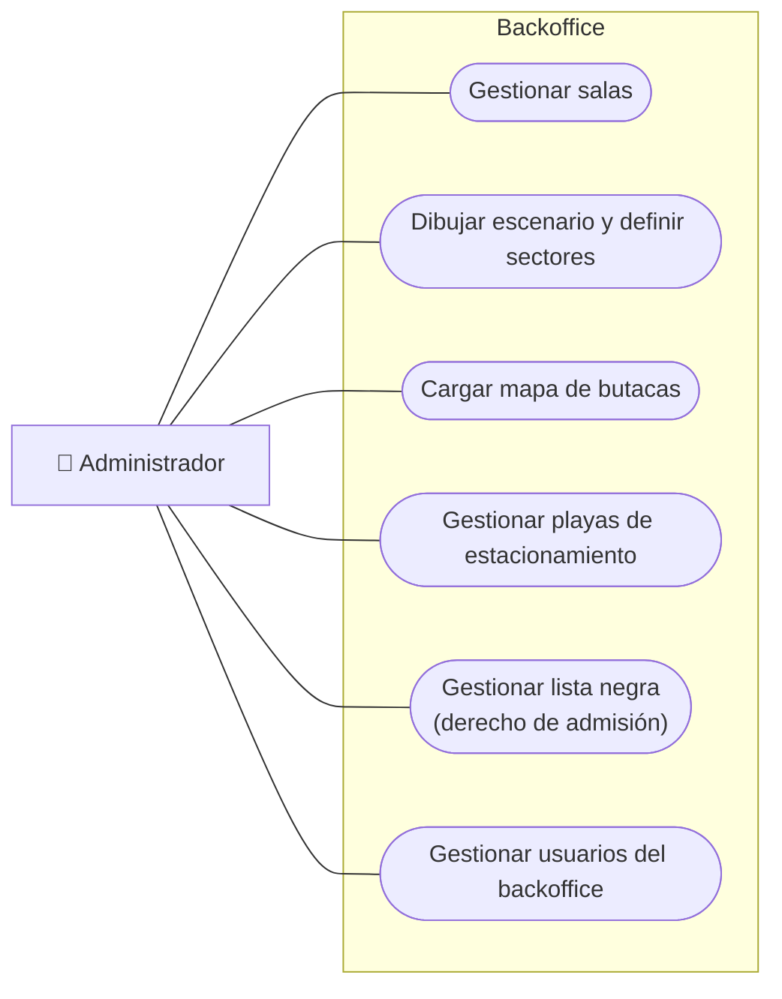

### 1.2. Actor Organizador (Backoffice)

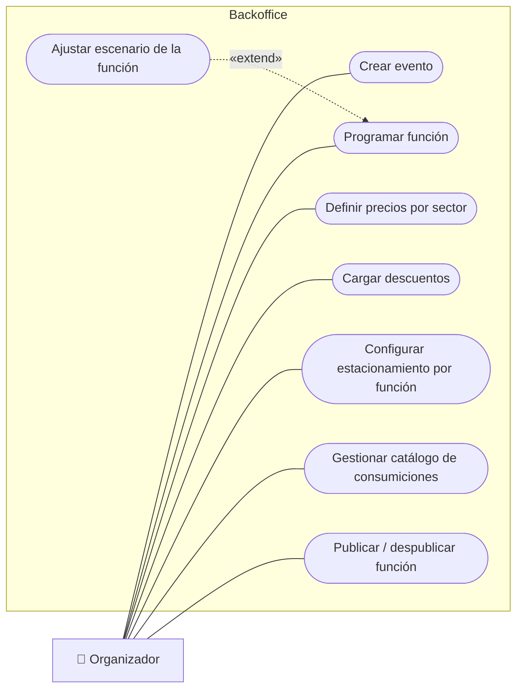

### 1.3. Casos de uso compartidos

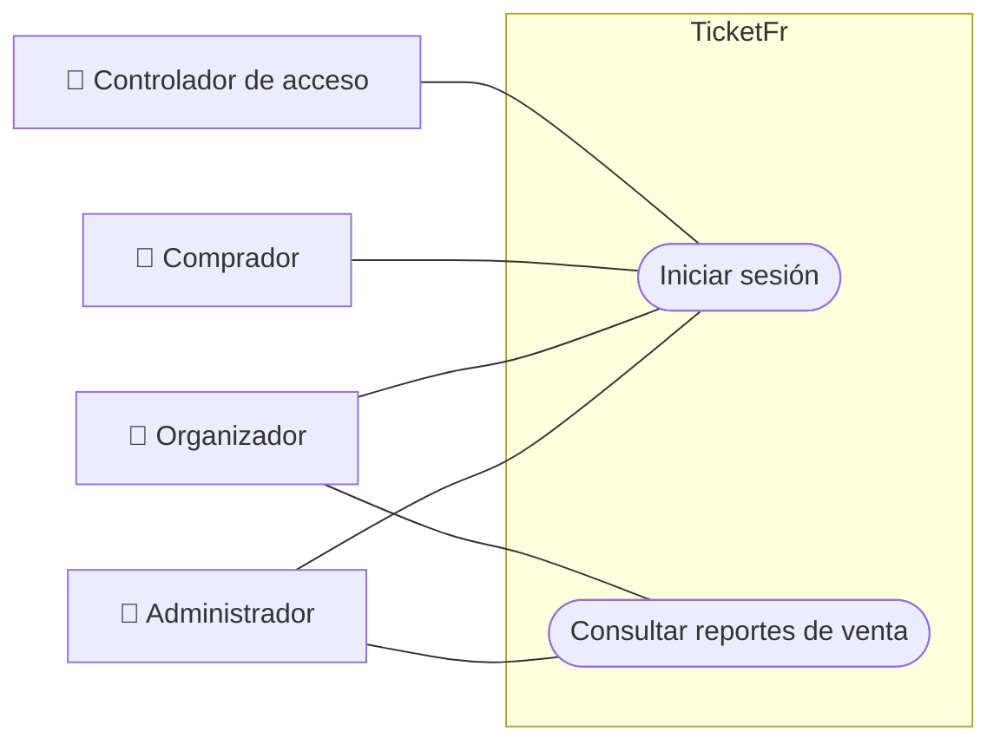

### 1.4. Actor Comprador (Portal de venta)

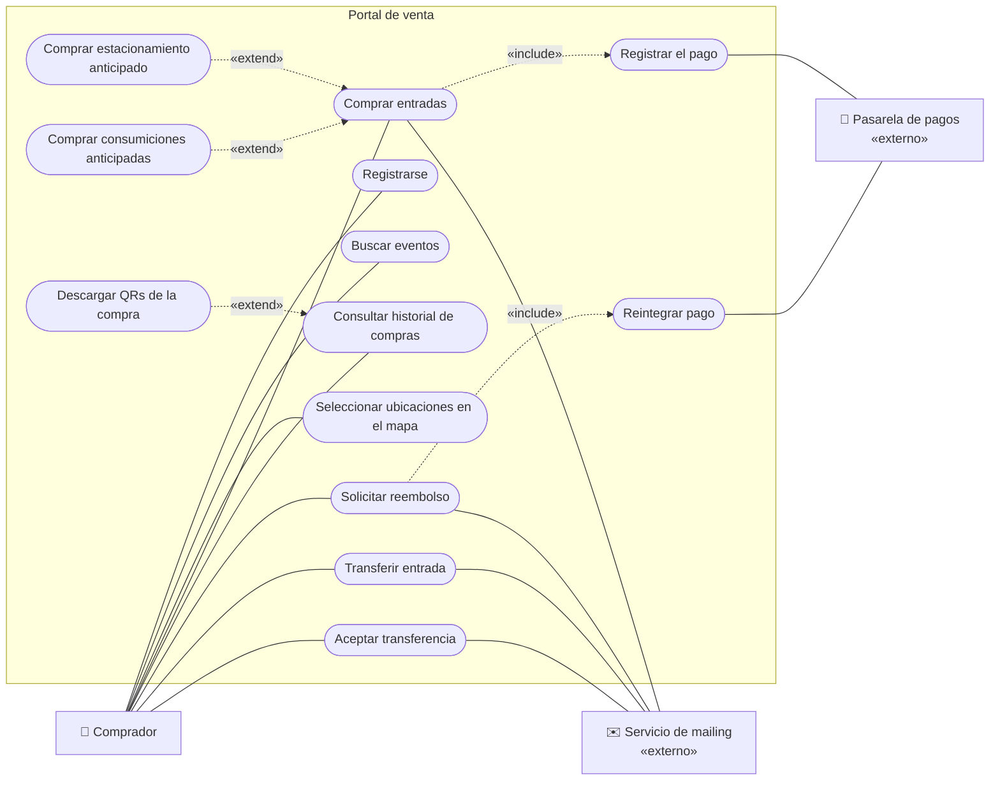

> **Reglas de negocio que no son casos de uso** (van en la descripción textual): reserva de 10 min, tope de 6 entradas por función, ventana de 48 h para el reembolso, verificación de lista negra al comprar y al aceptar una transferencia.

### 1.5. Actor Controlador de acceso

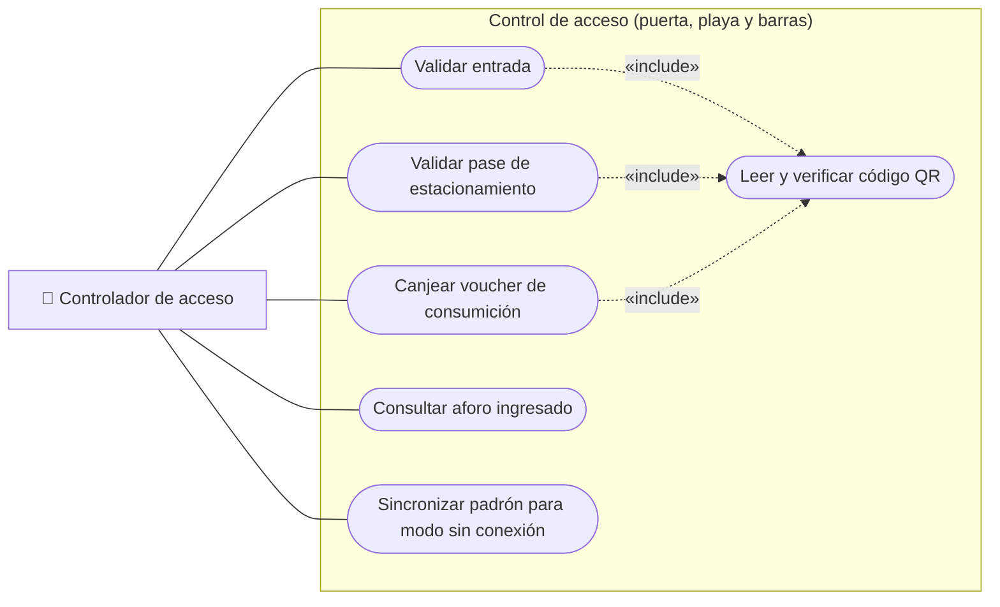

## 2. Vista 2: Clases — ¿Qué entidades existen y cómo se relacionan?

### 2.1. Modelo de dominio

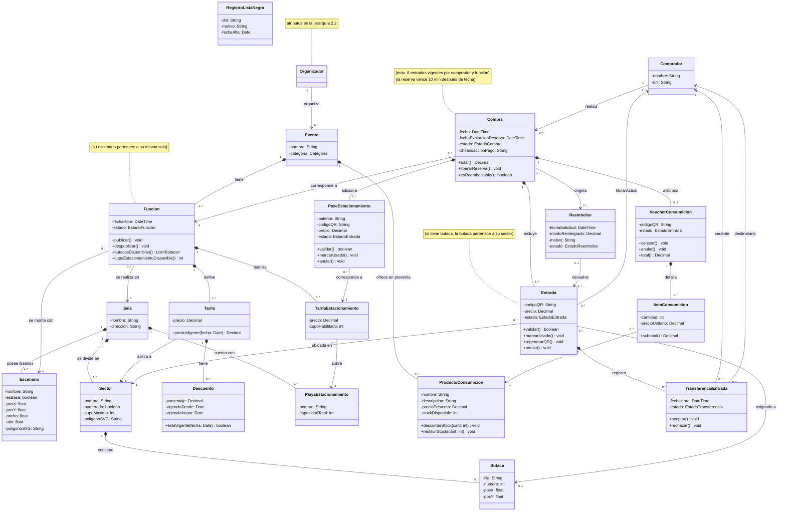

### 2.2. Jerarquía de usuarios

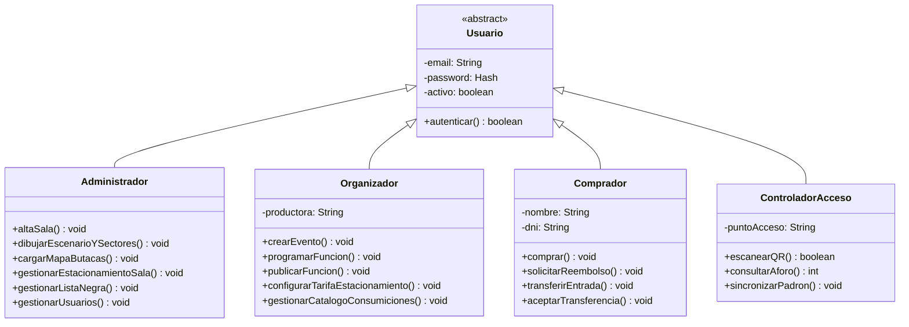

> `Comprador` y `Organizador` son **la misma clase** en las dos vistas: el email y la contraseña los heredan de `Usuario`.

### 2.3. Enumeraciones

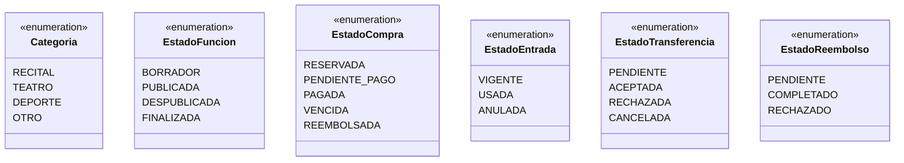

---

## 3. Vista 3: Actividades — ¿Cómo fluye el trabajo?

Cada diagrama usa **calles** (actor / sistema / externos), nodo inicial ●, nodo final ◉, decisiones ◇ y barras negras de **bifurcación/unión** (fork/join) para lo que ocurre en paralelo.

### 3.1. Comprar entradas (con adicionales y pago)

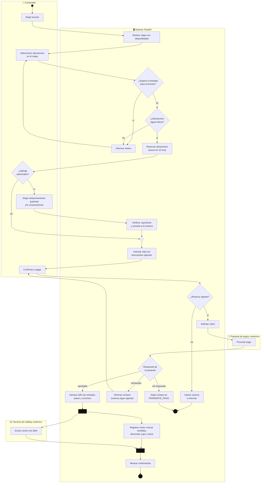

### 3.2. Vencimiento de la reserva (evento temporal)

La reserva de 10 minutos no aparece en casos de uso ni en clases: es **comportamiento temporal**, y se modela acá.

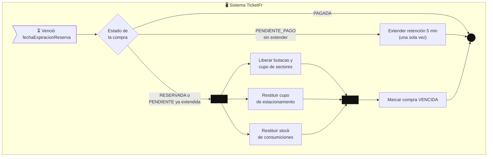

### 3.3. Solicitar reembolso

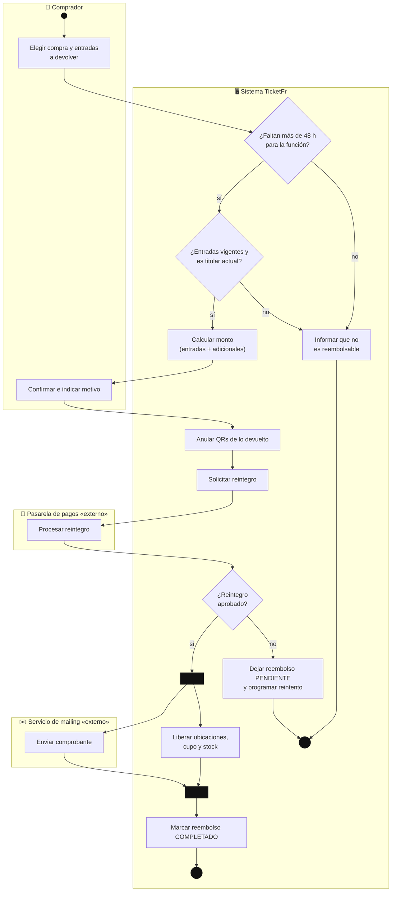

### 3.4. Transferir y aceptar una entrada

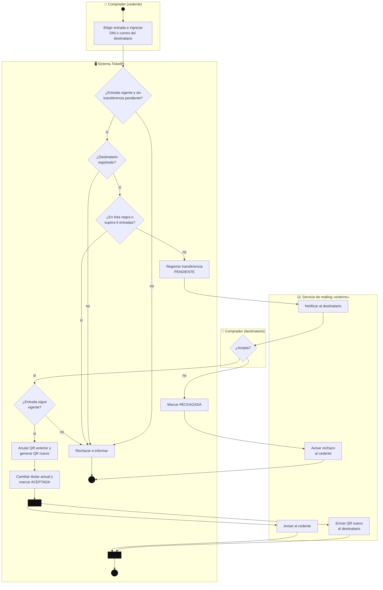

### 3.5. Validar QR en puerta, playa o barra

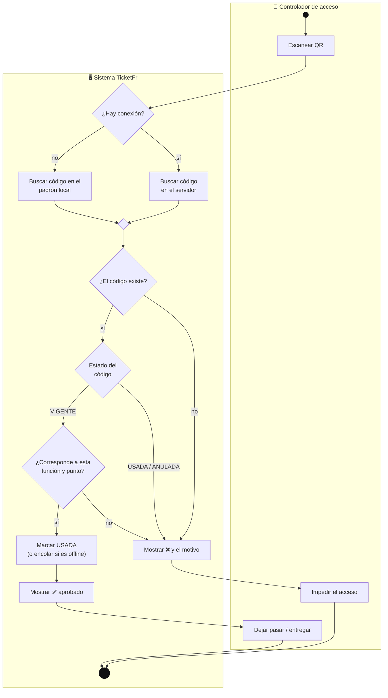

### 3.6. Preparar y publicar una función (organizador)

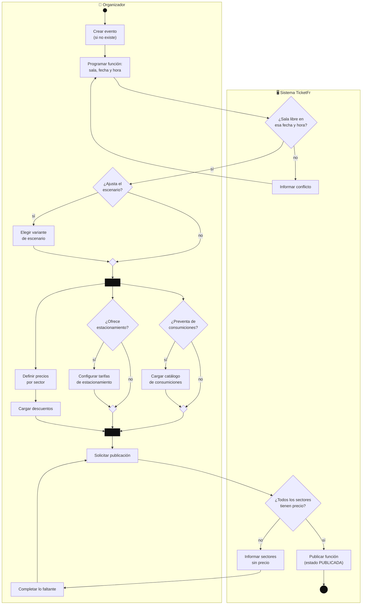

---
